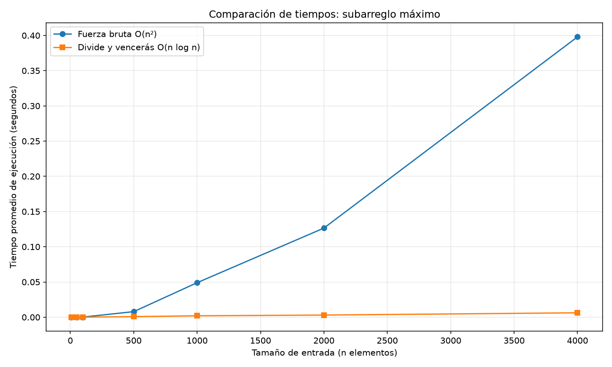

# Laboratorio evaluativo 02 — Subarreglo máximo y Divide y Vencerás
### **Nombre:** Alejandra Madrid Calderón

## Instrucciones para reproducir el experimento

### Requisitos

Para ejecutar los experimentos se requiere Python 3 y la biblioteca `matplotlib`.

El proyecto utiliza un entorno virtual para instalar y ejecutar las dependencias del laboratorio.

### Activar el entorno virtual
#### Instrucciones de ejecución por Sistema Operativo
Desde la carpeta raíz del repositorio:
1. En Windows (PowerShell / Command Prompt)

```powershell
# Activar el entorno virtual
.\venv\Scripts\activate

# Instalar dependencias (si no han sido instaladas previamente)
pip install -r requirements.txt

# Ejecutar las pruebas de verificación
python laboratorios/lab2-divide-y-vencer/pruebas.py

# Ejecutar el experimento de medición de tiempos y generación de gráficas
python laboratorios/lab2-divide-y-vencer/medicion.py 
```
2. En macOS y Linux (Bash / Zsh Terminal)
```powershell
# Activar el entorno virtual
source venv/bin/activate

# Instalar dependencias
pip install -r requirements.txt

# Ejecutar las pruebas de verificación
python laboratorios/lab2-divide-y-vencer/pruebas.py

# Ejecutar el experimento de medición de tiempos y generación de gráficas
python laboratorios/lab2-divide-y-vencer/medicion.py 
```

## Parte 1 — Implementación y pruebas

**Código:** [`subarreglo.py`](subarreglo.py) 

**Pruebas:** [`pruebas.py`](pruebas.py)

Se implementaron dos algoritmos para encontrar la suma maxima de un subarreglo consecutivo: fuerza bruta y divide y venceras. Se verifico que ambos obtuvieran la misma suma maxima.

Las dos soluciones se probaron con el script `pruebas.py`, utilizando sentencias `assert` para comprobar que los resultados fueran correctos en los siguientes casos:

* **Serie del enunciado:** Caso de 8 días de la cooperativa `[-3, 5, -2, 8, -6, 3, 9, -4]`, confirmando que ambos métodos entregan una suma máxima de **17**.
* **Caso base de un solo elemento:** Evaluado con `[7]`, retornando **7**.
* **Serie de valores estrictamente negativos:** Evaluado con `[-8, -3, -6, -2, -9]`, verificando que devuelva el menor de los impactos negativos (**-2**) en lugar de recortar a 0.
* **Serie de valores strictly positivos:** Evaluado con `[2, 4, 1, 3]`, confirmando la suma total acumulada (**10**).
* **Caso de cruce central directo:** Evaluado sobre `[4, -1, 5, 6]`, validando que `suma_cruzada` capture de forma exacta la mejor racha entre ambas mitades (**14**).
* **Verificación aleatoria estocástica:** Generación de 30 listas con semilla fija (`random.Random(42)`) para tamaños $n \in [1, 30]$, comparando la coincidencia de sumas entre ambos algoritmos.

## Parte 2 — Medición experimental

**Código:** [`medicion.py`](medicion.py)

Se midió el tiempo de ejecución para tamaños de 10, 50, 100, 500, 1.000, 2.000 y 4.000 elementos. Se utilizó `time.perf_counter()` y se promediaron tres ejecuciones por algoritmo y tamaño. Además, se verificó que ambos algoritmos produjeran la misma suma máxima.

### Gráfica de tiempos vs n elementos



La gráfica muestra el tiempo promedio en segundos para cada tamaño de entrada. Fuerza bruta presenta un crecimiento más pronunciado, mientras que divide y vencerás mantiene tiempos menores al aumentar el tamaño.

## Parte 3 — Análisis
### 1. Recurrencia

**Divide y vencerás** resuelve dos subproblemas de tamaño aproximado  $(n/2)$. Después calcula la mejor suma que cruza el punto medio recorriendo los elementos de ambos lados, operación que cuesta  $\Theta(n)$. Comparar los tres resultados cuesta $\Theta(1)$. Por tanto:


$$
T(n)=2T(n/2)+\Theta(n)
$$

En el método maestro,  $a=2$, $b=2$ y $f(n)=\Theta(n)$. Como:

$$
n^{\log_b a}=n^{\log_2 2}=n
$$

se cumple el caso 2: $f(n)=\Theta(n^{\log_b a})$, equivalente a $k=0$ en $\Theta(n^{\log_b a}\log^k n)$
Así, $T(n)=\Theta(n\log n)$.


Por su parte, **Fuerza Bruta** es $\Theta(n^2)$ porque evalúa todos los pares de índices posibles mediante dos ciclos anidados. El número de operaciones es proporcional a $n+(n-1)+\dots+1=\frac{n(n+1)}{2}$  
= $\frac{n^2 + n}{2}$, dominado asintóticamente por el término cuadrático $n^2$.
### 2. Lo medido contra lo esperado

La gráfica nos muestra con claridad las complejidades teóricas: la curva de Fuerza Bruta describe una trayectoria parabólica con un crecimiento acelerado, mientras que Divide y Vencerás se mantiene prácticamente plana.

Al comparar los tamaños consecutivos donde $n$ se duplica de $n = 2000$ a $n = 4000$:
- **Fuerza Bruta:** Pasó de $0.12651537\text{ s}$ a $0.39801290\text{ s}$. El tiempo se multiplicó por 
$\frac{0.39801290}{0.12651537} \approx 3.15$ veces.
 Este valor se aproxima al factor teórico esperado de $2^2 = 4$, confirmando la naturaleza cuadrática $\Theta(n^2)$.

- **Divide y Vencerás:** Pasó de $0.00302857\text{ s}$ a $0.00624617\text{ s}$. El tiempo se multiplicó por $\frac{0.00624617}{0.00302857} \approx 2.06$ veces. Coincide con la predicción de $\Theta(n \log n)$, donde el factor teórico de aceleración es $\frac{4000 \log_2(4000)}{2000 \log_2(2000)} \approx 2 \times \frac{11.96}{10.96} \approx 2.18$.

Fuerza bruta aumento unas 3.15 veces y divide y venceras unas 2.06 veces. Aunque no coinciden exactamente con los factores teoricos aproximados de 4 y 2, las tendencias concuerdan con $\Theta(n^2)$ y  $\Theta(n \log n)$. Las diferencias pueden deberse al entorno de ejecucion y a los costos de medición.

### 3. Tamaños pequeños

En las mediciones, **Divide y Vencerás** empieza a ganar a partir de $n = 50$, registrando $0.00005457\text{ s}$ frente a $0.00005647\text{ s}$ de Fuerza Bruta.  Para $n = 10$, **Fuerza Bruta** resultó ser más rápida ($0.00000437\text{ s}$ frente a $0.00000973\text{ s}$).

Esto se explica porque en entradas muy reducidas ($n < 50$), la sobrecarga (overhead) de gestión de llamadas recursivas en la pila y la asignación de memoria superan el costo computacional de las pocas operaciones directas que realiza el algoritmo cuadrático.

### 4. ¿Cuándo conviene dividir?
Al evaluar el problema de **hallar el elemento máximo de un arreglo**, dividir a la mitad NO genera una mejora frente a un recorrido iterativo simple. 

Si se aplicara Divide y Vencerás para hallar el máximo, la combinación consistiría en tomar el mayor entre los máximos de cada mitad mediante una sola comparación ($\Theta(1)$), lo que resulta en 
$T(n) = 2T(n/2) + \Theta(1)$. Por el Caso 1 del Método Maestro ($n^{\log_2 2} = n$), esta solución es $\Theta(n)$.

Ya que el recorrido iterativo mediante un ciclo for también es $\Theta(n)$ pero con un consumo de memoria $O(1)$, dividir  no aporta ventajas y solo añade la sobrecarga de la recursión. Por lo tanto esta técnica solo es útil cuando combinar las soluciones es más barato que resolver el problema de forma directa.

### 5. Concepto para la gerente

Se recomienda divide y vencerás para procesar un millón de registros, porque su crecimiento $\Theta(n\log n)$ es menor que el de fuerza bruta, $\Theta(n^2)$.

**Estimación:** usando los tiempos de 4.000 elementos como referencia, para fuerza bruta:

$$
T(10^6)\approx0.39801290
\left(\frac{10^6}{4000}\right)^2
\approx24875.81\text{ s}
$$

Esto equivale aproximadamente a 6,91 horas.

Para divide y vencerás:

$$
T(10^6)\approx0.00624617
\frac{10^6\log_2(10^6)}
{4000\log_2(4000)}
\approx2.60\text{ s}
$$

Estos datos nos demuestran que Fuerza Bruta no sirve para trabajar con muchos datos, ya que procesar un millón de días le tomaría mas de 6 horas, dejando el sistema totalmente colgado. En cambio, Divide y Vencerás es mucho mas eficiente y resuelve esa misma cantidad de información en solo 2.6 segundos. Por eso, para la plataforma de la cooperativa, Divide y Vencerás es la opción más viable y rápida.


