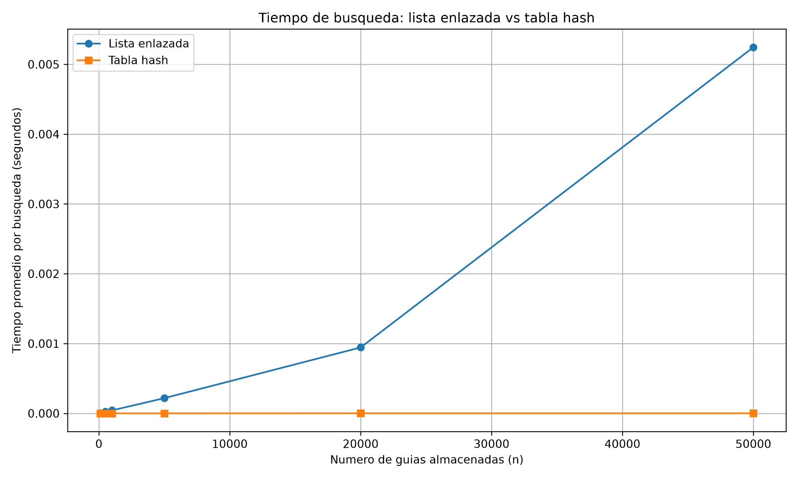
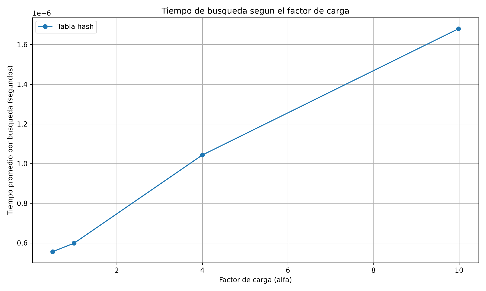

# Laboratorio 3 — Estructuras de datos
### **Nombre:** Alejandra Madrid Calderón

## Instrucciones para reproducir el experimento

### Requisitos

Para ejecutar los experimentos se requiere Python 3 y la biblioteca `matplotlib`.

El proyecto utiliza un entorno virtual para instalar y ejecutar las dependencias del laboratorio.

### Activar el entorno virtual
#### Instrucciones de ejecución por Sistema Operativo
Desde la carpeta raíz del repositorio:
1. En Windows (PowerShell / Command Prompt)

```powershell
# Activar el entorno virtual
.\venv\Scripts\activate

# Instalar dependencias (si no han sido instaladas previamente)
pip install -r requirements.txt

# Ejecutar las pruebas de verificación
python laboratorios/lab3-estructuras-datos/pruebas.py

# Ejecutar el experimento de medición de tiempos y generación de gráficas
python laboratorios/lab3-estructuras-datos/medicion.py 
```
2. En macOS y Linux (Bash / Zsh Terminal)
```powershell
# Activar el entorno virtual
source venv/bin/activate

# Instalar dependencias
pip install -r requirements.txt

# Ejecutar las pruebas de verificación
python laboratorios/lab3-estructuras-datos/pruebas.py

# Ejecutar el experimento de medición de tiempos y generación de gráficas
python laboratorios/lab3-estructuras-datos/medicion.py 
```


## Parte 1. Implementación de las estructuras

Se implementaron dos estructuras para almacenar y consultar las guías de envío:

- **Lista enlazada:** almacena los elementos mediante nodos conectados. La inserción se realiza al inicio en tiempo Θ(1), mientras que la búsqueda requiere recorrer los nodos hasta encontrar la guía o llegar al final, con complejidad Θ(n).
- **Tabla hash:** utiliza el método de división `guia % m` para determinar la casilla donde se almacena cada guía. Se implementó mediante encadenamiento, utilizando una lista enlazada en cada casilla para manejar las colisiones. Su búsqueda tiene un costo promedio Θ(1 + α), suponiendo una distribución uniforme de las claves.

La implementación se encuentra en [estructuras.py](estructuras.py) y las pruebas de funcionamiento en [pruebas.py](pruebas.py).

Las pruebas verifican búsquedas exitosas e infructuosas, colisiones, factor de carga y equivalencia de resultados entre ambas estructuras mediante 20 colecciones aleatorias.

## Parte 2. Experimentos de rendimiento

Los experimentos se desarrollaron en [medicion.py](medicion.py), utilizando `time.perf_counter()` para medir el tiempo promedio de búsqueda. En ambos experimentos se realizaron 200 consultas de guías inexistentes por estructura o configuración. La generación de datos y la construcción de las estructuras se realizaron antes del cronometraje.

### Experimento A. Lista enlazada vs. tabla hash

Se evaluaron seis tamaños de entrada. Para cada tamaño se seleccionó un número primo de casillas cercano a la mitad de la cantidad de guías, manteniendo un factor de carga aproximado de 2.

| Guías (n) | Casillas (m) | Factor de carga | Lista (s) | Tabla hash (s) |
|---:|---:|---:|---:|---:|
| 100 | 53 | 1.8868 | 0.00000406 | 0.00000024 |
| 500 | 251 | 1.9920 | 0.00002650 | 0.00000029 |
| 1.000 | 503 | 1.9881 | 0.00004287 | 0.00000030 |
| 5.000 | 2.503 | 1.9976 | 0.00021815 | 0.00000063 |
| 20.000 | 10.007 | 1.9986 | 0.00094466 | 0.00000118 |
| 50.000 | 25.013 | 1.9990 | 0.00524420 | 0.00000115 |

**Gráfica de resultados:**



Los resultados muestran que el tiempo de búsqueda de la lista enlazada aumenta con el número de guías, mientras que la tabla hash conserva tiempos considerablemente menores.

### Experimento B. Efecto del factor de carga

Se mantuvo constante la cantidad de 20.000 guías y se modificó el número de casillas para evaluar cuatro factores de carga diferentes.

| Guías (n) | Casillas (m) | Factor de carga | Tiempo promedio (s) |
|---:|---:|---:|---:|
| 20.000 | 40.009 | 0.4999 | 0.00000056 |
| 20.000 | 20.011 | 0.9995 | 0.00000060 |
| 20.000 | 5.003 | 3.9976 | 0.00000104 |
| 20.000 | 2.003 | 9.9850 | 0.00000168 |

**Gráfica de resultados:**



Se observa que el tiempo promedio de búsqueda aumenta a medida que crece el factor de carga, debido a que se incrementa la cantidad promedio de elementos almacenados en cada casilla.

